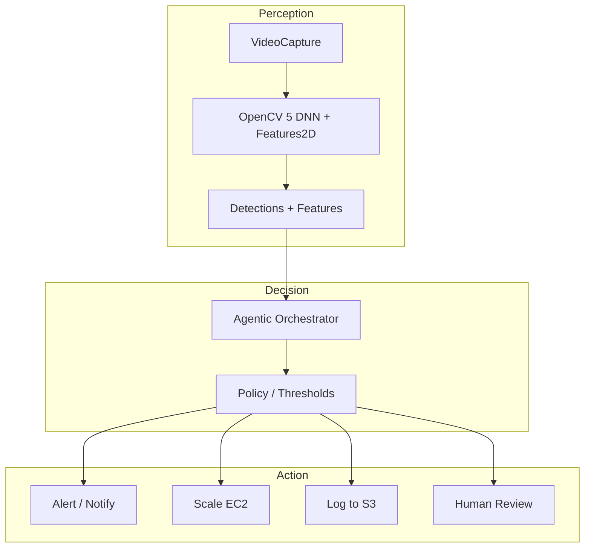

# Agentic Vision Award — Gap Analysis

The current Gravisonde submission targets the **COOL Award** only.

## What is missing for Agentic Vision Award

Per competition requirements:
1. Agent workflow diagram showing perception, decision/orchestration, action
2. Trace/demonstration showing OpenCV 5 output changes a later decision, tool call, or action
3. Evaluation of task success, failure handling, observability, appropriate human control

Gravisonde currently has no autonomous agent loop. The pipeline is a deterministic video analytics benchmark:
Perception → Metrics → Dashboard

No decision logic, tool calling, or closed-loop action is implemented.

## Optional agent extension sketch

If desired, an agentic layer could be added on top of the existing pipeline:

**Evidence required**
- Trace log: OpenCV detection count > threshold → agent triggers scaling action
- Success metrics: false positive rate, latency of action
- Failure handling: detection failure fallback to synthetic mode, human override

**Recommendation**
Keep submission focused on COOL Award where all required evidence is present and complete. Agentic Vision would require new code and evaluation — not ready for current deadline.

If you want, I can draft a minimal agent wrapper around the existing metrics stream to demonstrate the pattern, but it would be a stretch feature.
