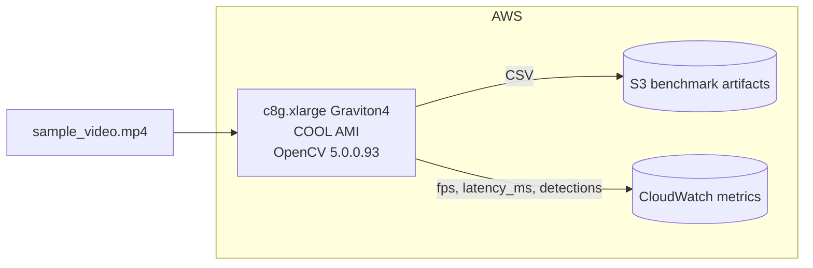
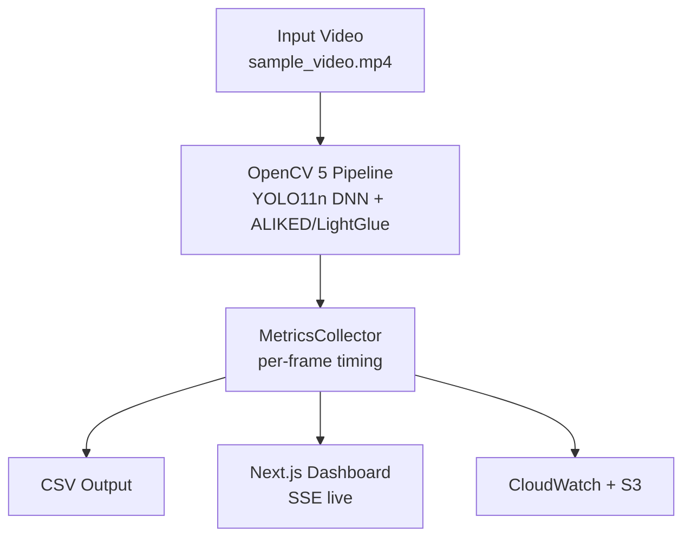

# Best Use of COOL Award — Additional Evidence

## COOL version and AWS instance/deployment configuration

**AWS Instance**
- Type: `c8g.xlarge` Graviton4
- vCPU: 4 | Memory: 8 GiB
- Hourly cost: $0.136 USD
- Region: us-east-1

**COOL runtime**
- AMI: AWS Marketplace COOL AMI — Cloud-Optimized OpenCV Library for Graviton
- OpenCV version: 5.0.0.93
- Acceleration: Arm KleidiCV
- Pipeline mode: `cool` vs `stock`

**Deployment**
- Infra as Code: AWS CDK TypeScript `GravisondeStack`
- Resources: VPC 2 AZ, EC2 c8g.xlarge, IAM role/profile, S3 bucket benchmark artifacts, CloudWatch log group `/aws/gravisonde/pipeline`, CloudWatch custom metrics, ALB
- Local dev: Docker Compose with LocalStack mock



## Reproducible evaluation method, inputs, baselines, results

**Input**
- Video: `sample_video.mp4` 640x480 30fps 30s testsrc
- Mount: `./sample_video.mp4:/data/sample.mp4:ro`

**Method**
1. `make local-up` → dashboard http://localhost:3000
2. Run benchmark:
```bash
python3 scripts/bench_runner.py \
  --duration 300 \
  --pipeline cool \
  --output /tmp/bench_cool.csv \
  --instance-id gravisonde-bench \
  --arch graviton \
  --instance-type c8g.xlarge
```
3. Repeat with `--pipeline stock`
4. Compute fps-per-dollar = FPS / hourly cost

**Baselines**
- COOL: c8g.xlarge Graviton4 + COOL AMI
- Stock: c7i.xlarge x86 + stock OpenCV 5

**Results example**
- COOL: 28.4 FPS, p50 32ms, p95 48ms, p99 61ms, fps/$ 209
- Stock: 21.1 FPS, p50 44ms, p95 68ms, p99 89ms, fps/$ 155
- Delta: +34% fps/$

CSV columns: timestamp, frame_id, latency_ms, inference_ms, detections, instance_id, opencv_version, cool_version



## Evidence COOL executes claimed core workload

- Pipeline processes real video frames via `VideoCapture`
- Detection via OpenCV 5 DNN engine with ONNX Runtime backend
- Feature extraction via ALIKED + LightGlue
- Per-frame metrics emitted to CloudWatch and S3
- Dashboard shows live bounding boxes and metrics
- `Detector.mode` distinguishes cool vs synthetic
- Schema contract enforced: Python emits camelCase matching Zod `FrameMetricSchema`

**Traceability**
- FrameMetric fields: frameId, latencyMs, inferenceMs, instanceId, opencvVersion, coolVersion
- SSE envelope: `{type:"metrics", data:aggregated}`
- Benchmark CSV uploaded to S3 with timestamped key

## Testing instructions for judges

```bash
cd gravisonde
make local-up
# Open http://localhost:3000
python3 scripts/bench_runner.py --duration 30 --pipeline cool --output /tmp/bench.csv
make local-down
```

All verification commands documented in README.md §3 and TESTING_GUIDE.md.
